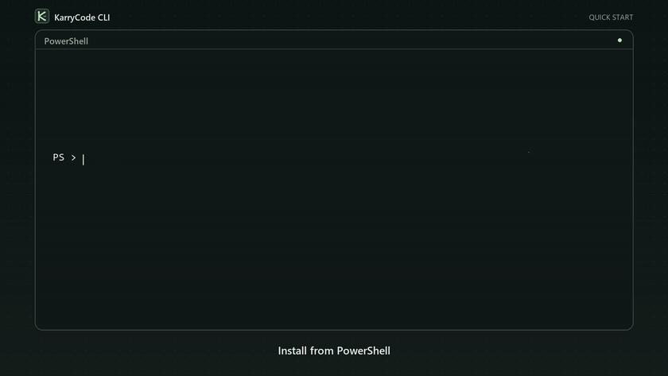

<p align="center">
  
</p>

<p align="center">
  <strong>A Rust coding agent for your terminal.</strong><br>
  Connect your model, review changes, and preview your work.
</p>

<p align="center">
  <a href="https://github.com/harzer228/KarryCode/releases/latest"></a>
  <a href="LICENSE"></a>
  <a href="#requirements"></a>
  <a href="https://github.com/harzer228/KarryCode/actions/workflows/ci.yml"></a>
</p>

<p align="center"><strong>English</strong> · <a href="docs/README.ru.md">Русский</a> · <a href="#windows-resource-use">Benchmark</a></p>

## Quick demo

[](https://harzer228.github.io/KarryCode/demo/)

The demo shows a PowerShell install, `/cd`, model selection, and a local site preview. It uses a test model and compresses waiting time. [Play with sound](https://harzer228.github.io/KarryCode/demo/) · [Смотреть на русском](https://harzer228.github.io/KarryCode/demo/ru.html)

## Install

**Windows x64** (Windows PowerShell 5.1 or PowerShell 7)

```powershell
irm https://raw.githubusercontent.com/harzer228/KarryCode/main/install.ps1 | iex
karrycode
```

**Linux x64** (Ubuntu or Arch)

```sh
curl -fsSL https://raw.githubusercontent.com/harzer228/KarryCode/main/install.sh | sh
~/.local/bin/karrycode
```

**Cargo** (build from a GitHub release tag with Rust 1.100.0)

```sh
cargo install --git https://github.com/harzer228/KarryCode --tag v1.2-beta --locked
```

The scripts verify the downloaded file against the release's SHA-256 manifest. Repeat the install command to update. Windows adds `karrycode` to your user PATH. On Linux, add `~/.local/bin` to your PATH if you want to use the shorter command. [Binaries and checksums](https://github.com/harzer228/KarryCode/releases/latest)

## Start a project

1. Run `karrycode` from a project folder or pass its path as the first argument. Use `/cd` to switch folders in the same conversation.
2. On first launch, the setup wizard asks for a provider, a connection and a default model. You can choose from the catalog or enter a model ID and its limits. If you skip setup or use an older release, add these later with `/provider` and `/model`.
3. Ask for a change, review the proposed actions, and open the preview link for a static web project.

| Command | What it does |
| --- | --- |
| `/permissions` | Manage chat mode and action approvals |
| `/plan` and `/code` | Prepare and review a plan before implementation |
| `/setting` | Change language, theme, desktop access, subagent limit and parallel requests per connection |
| `/skills` and `/mcp` | Discover skills and manage MCP servers |
| `/help` | List chat commands and key bindings |

## Requirements

| Platform | Supported tools |
| --- | --- |
| Windows 11 x64 | CLI, browser tools, desktop control |
| Ubuntu and Arch Linux x64 | CLI and browser tools |

Browser automation uses an installed Chromium-based browser. With a cloud model, you need internet access and provider credentials. With a local model, start a compatible server separately, such as Ollama. KarryCode supports OpenAI Chat Completions, OpenAI Responses and Anthropic Messages. It is the standalone terminal agent in the [CarryCode ecosystem](https://github.com/harzer228/CarryCode).

## Tool comparison

Features depend on the platform and client. The Windows benchmark below measures resource use and time to the first interactive prompt.

| Criterion | KarryCode | Claude Code | Aider | Cline |
| --- | --- | --- | --- | --- |
| Implementation and startup | Native Rust executable | Distributed CLI | Python package | TypeScript CLI source and packaged binaries |
| Own or local models | Custom endpoints and compatible local servers | Gateways and compatible local servers such as Ollama | Custom providers and local servers such as Ollama | Custom providers and local models |
| Built-in live preview | Loopback server for static sites and optional Chromium tools | Dev-server preview in Claude Code Desktop | Browser UI for interacting with Aider. Project preview unverified | Browser tools for testing. Integrated CLI preview server unverified |
| Desktop control | Windows | Documented macOS computer use | Unverified | CLI desktop control unverified |
| Key storage | Encrypted local profile with OS-backed unlock or password | macOS Keychain or a permissions-protected credentials file | Environment variables, `.env`, or configuration files | Local secrets file with restricted permissions. CLI encryption unverified |

- [Claude Code gateways](https://code.claude.com/docs/en/llm-gateway) · [Ollama integration](https://github.com/ollama/ollama/blob/main/docs/integrations/claude-code.mdx) · [Desktop preview](https://code.claude.com/docs/en/desktop#preview-your-app) · [Computer use](https://code.claude.com/docs/en/computer-use) · [Authentication](https://code.claude.com/docs/en/authentication)
- [Aider package](https://github.com/Aider-AI/aider/blob/main/pyproject.toml) · [Local models](https://aider.chat/docs/llms/ollama.html) · [Browser UI](https://aider.chat/docs/usage/browser.html) · [API keys](https://aider.chat/docs/config/api-keys.html)
- [Cline CLI](https://github.com/cline/cline/blob/main/apps/cli/README.md) · [Local models](https://docs.cline.bot/running-models-locally/overview) · [Browser tools](https://cline.bot/install) · [Secret storage](https://github.com/cline/cline/blob/main/.clinerules/storage.md#storage-architecture)

## Windows resource use

**KarryCode used 14.1 MiB of RAM while streaming**, the lowest working set among the four CLIs in this test. Saving the encrypted conversation briefly raised its working set to about 270 MiB before it returned to about 14.3 MiB.

| CLI | Idle RAM, MiB | Streaming peak, MiB | Full-turn peak, MiB | Streaming CPU |
| --- | ---: | ---: | ---: | ---: |
| **KarryCode (1.2-beta development build)** | **12.3** | **14.1** | **270.2** | **0.075%** |
| Aider 0.86.2 | 200.2 | 248.2 | 248.4 | 0.387% |
| Claude Code 2.1.328 | 233.8 | 284.3 | 284.3 | 0.248% |
| OpenCode 2.2.5 | 414.7 | 523.0 | 523.0 | 0.326% |

Each value is the median of three runs on Windows 11 with an Intel Core i3-10105F. Every CLI streamed the same reply from a loopback test API. CPU percentages are relative to all eight logical CPUs. [Method, raw runs and reproduction](benchmarks/windows.md)

## Security & Privacy

- **Provider traffic.** KarryCode sends model requests to the connection you selected. Requests can contain the prompt, conversation context, attachments and tool results. The API key authenticates with that connection. Catalog requests go to the same provider.
- **Search, browser and MCP.** Web search sends your query to the search service selected in `/search`. Browser tools connect to the pages they open. Approved MCP servers can make their own requests. The built-in static preview listens on loopback.
- **Local credentials.** Provider keys, model settings and chat history live in an age-encrypted profile. Windows uses DPAPI for the current user. Linux uses Secret Service when available or a profile password. While unlocked, the profile uses a protected local working directory.
- **Desktop access.** On Windows, enable or pause desktop tools in `/setting`. Ask and Auto modes request consent on first desktop use in each chat. Full access grants consent when desktop tools are enabled. The model may receive window titles, UI elements or screenshots. Press `Ctrl+Alt+Shift+F12` to stop desktop control.

## Uninstall

On Windows, run:

```powershell
& ([scriptblock]::Create((irm https://raw.githubusercontent.com/harzer228/KarryCode/main/install.ps1))) -Uninstall
```

On Linux, run:

```sh
curl -fsSL https://raw.githubusercontent.com/harzer228/KarryCode/main/install.sh | sh -s -- --uninstall
```

Uninstalling keeps the encrypted profile for a later install.

[Contributing](CONTRIBUTING.md) · [Security](SECURITY.md) · [Changelog](CHANGELOG.md)
