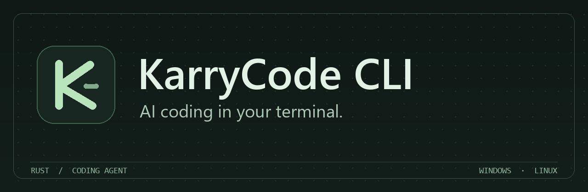
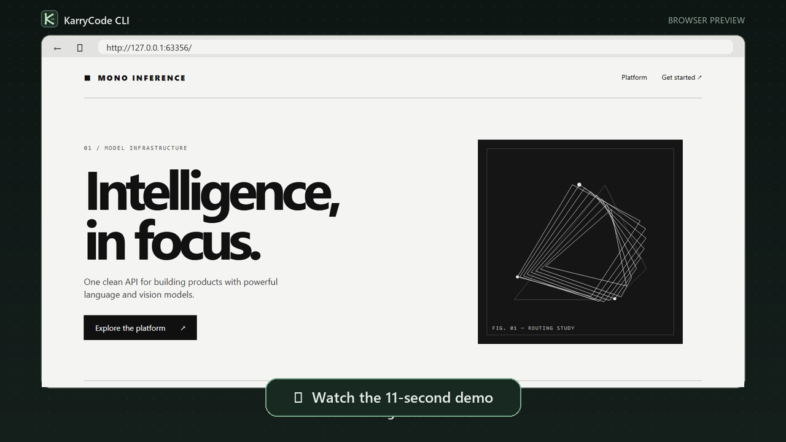

<p align="center">
  
</p>

[](https://github.com/harzer228/KarryCode/actions/workflows/ci.yml)
[](https://github.com/harzer228/KarryCode/releases/latest)
[](LICENSE)
· [Русский](docs/README.ru.md)

**KarryCode is a Rust coding agent that opens in your project folder.** Bring your own model provider, review file changes in the terminal, and preview the result in a browser. KarryCode is part of the [CarryCode ecosystem](https://github.com/harzer228/CarryCode) and installs as a standalone CLI.

## Install on Windows

In Windows PowerShell 5.1 or PowerShell 7:

```powershell
irm https://raw.githubusercontent.com/harzer228/KarryCode/main/install.ps1 | iex
karrycode
```

The installer checks SHA-256 and adds `karrycode` to your user PATH and the current session. Run it again to update. To choose another project at launch, run `karrycode "D:\My Project"`.

## 11-second quick start

[](https://github.com/harzer228/KarryCode/releases/download/v0.1.0-beta.1/karrycode-quickstart.mp4)

The recording uses a labeled demo model and compresses waiting time. KarryCode performs the file changes and serves the preview locally. [Смотреть на русском](https://github.com/harzer228/KarryCode/releases/download/v0.1.0-beta.1/karrycode-quickstart-ru.mp4)

## Install on Linux

```sh
curl -fsSL https://raw.githubusercontent.com/harzer228/KarryCode/main/install.sh | sh
karrycode
```

The installer puts the executable in `~/.local/bin`. If that directory is missing from your PATH, use `~/.local/bin/karrycode` or add it to your shell configuration. The [release page](https://github.com/harzer228/KarryCode/releases/latest) has binaries and SHA-256 for manual installation.

## Start a project

1. Open `/provider` and add your connection. Supported protocols include OpenAI Chat Completions, OpenAI Responses and Anthropic Messages.
2. Open `/model`, choose a model and review its context, output and reasoning settings.
3. Ask for a change, review the proposed actions and open any preview link. Use `/cd` to switch project folders in the same conversation.

| Command | What it does |
| --- | --- |
| `/permissions` | Manage chat mode and action approvals |
| `/plan` and `/code` | Prepare and review a plan before implementation |
| `/setting` | Change language, theme, desktop access and subagent limits |
| `/skills` and `/mcp` | Discover skills and manage MCP servers |
| `/help` | List chat commands and key bindings |

KarryCode supports Windows 11 x64, Ubuntu x64 and Arch x64. Windows includes desktop control. Browser automation uses an installed Chromium-based browser. Cloud models require internet access and provider credentials. KarryCode ships the agent, while you choose where the model runs.

The local profile stores providers, settings and conversations in encrypted snapshots. Windows unlocks it through your Windows account. Linux uses an unlocked Secret Service keyring when available or asks for a profile password during setup.

## Uninstall

On Windows, run:

```powershell
& ([scriptblock]::Create((irm https://raw.githubusercontent.com/harzer228/KarryCode/main/install.ps1))) -Uninstall
```

On Linux, remove `~/.local/bin/karrycode`. Your encrypted profile remains available for a later install.

[Contributing](CONTRIBUTING.md) · [Security](SECURITY.md) · [Changelog](CHANGELOG.md)
