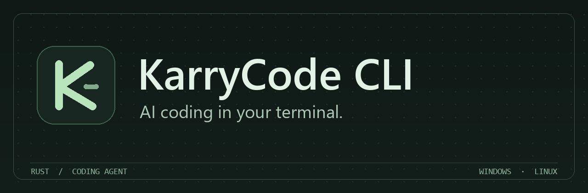
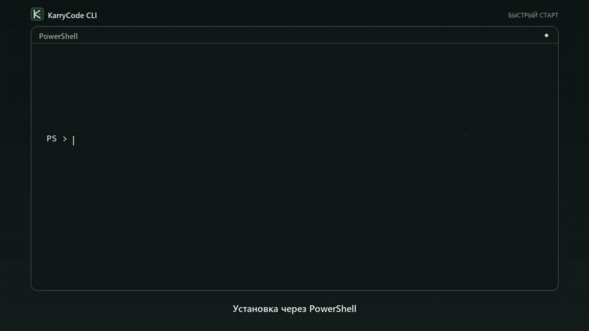

<p align="center">
  
</p>

<p align="center">
  <strong>Агент на Rust для работы с кодом в терминале.</strong><br>
  Подключи свою модель, проверь правки и открой предпросмотр проекта.
</p>

<p align="center">
  <a href="https://github.com/harzer228/KarryCode/releases/latest"></a>
  <a href="../LICENSE"></a>
  <a href="#требования"></a>
  <a href="https://github.com/harzer228/KarryCode/actions/workflows/ci.yml"></a>
</p>

<p align="center"><a href="../README.md">English</a> · <strong>Русский</strong> · <a href="#расход-ресурсов-на-windows">Замеры</a></p>

## Короткое демо

[](https://harzer228.github.io/KarryCode/demo/ru.html)

В ролике показаны установка через PowerShell, переход в проект через `/cd`, выбор модели и локальный предпросмотр сайта. Используется тестовая модель, ожидание сокращено. [Смотреть со звуком](https://harzer228.github.io/KarryCode/demo/ru.html) · [Watch in English](https://harzer228.github.io/KarryCode/demo/)

## Установка

**Windows x64** (Windows PowerShell 5.1 или PowerShell 7)

```powershell
irm https://raw.githubusercontent.com/harzer228/KarryCode/main/install.ps1 | iex
karrycode
```

**Linux x64** (Ubuntu или Arch)

```sh
curl -fsSL https://raw.githubusercontent.com/harzer228/KarryCode/main/install.sh | sh
~/.local/bin/karrycode
```

**Cargo** (сборка из тега GitHub на Rust 1.100.0)

```sh
cargo install --git https://github.com/harzer228/KarryCode --tag v1.2-beta --locked
```

Скрипты сверяют SHA-256 скачанных файлов с контрольными суммами релиза. Для обновления повтори команду установки. В Windows установщик добавляет `karrycode` в пользовательский PATH. В Linux можно добавить `~/.local/bin` в PATH для короткого вызова. [Релизы и контрольные суммы](https://github.com/harzer228/KarryCode/releases/latest)

## Сборка из main

После тега `v1.2-beta` в `main` появились `--print`, `/compact` и отдельные инструменты модели. Чтобы попробовать их из локальной копии `main`, выполни `cargo build --locked`. Бинарник появится в `target/debug/`. [Изменения в main](../CHANGELOG.md#unreleased)

## Первый проект

1. Запусти `karrycode` в папке проекта или передай путь после команды. Чтобы сменить папку в том же чате, используй `/cd`.
2. В мастере выбери провайдера, подтверди URL и выбери модель. Если каталога нет, введи ID и лимиты модели вручную. После пропуска мастера или в ранней версии настрой подключение в `/provider` и модель в `/model`.
3. Опиши задачу, проверь предлагаемые действия и открой ссылку предпросмотра, если проект содержит статический сайт.

| Команда | Назначение |
| --- | --- |
| `/permissions` | Режим чата и правила подтверждения |
| `/plan`, `/code`, `/tasks` | Подготовить и подтвердить план, посмотреть шаги и проверки |
| `/compact` | Сжать старую часть диалога в сводку |
| `/config` | Проверить конфиги моделей профиля и проекта |
| `/creator`, `/extensions` | Создать, протестировать и подключить расширение |
| `/theme`, `/panels` | Предпросмотр оформления и пользовательские панели |
| `/setting` | Язык, тема, рабочий стол и лимиты параллельных запросов |
| `/skills` и `/mcp` | Скиллы и серверы MCP |
| `/help` | Команды и клавиши |

### Контекст и инструменты модели

В сборке из `main` команда `/compact` просит активную модель сделать сводку из старых сообщений. KarryCode также может запустить сжатие автоматически примерно на 85% от оценочного лимита входа или когда запрос уже выходит за доступный бюджет. Сводка заменяет старую часть диалога. Последние сообщения и целые пары вызовов с результатами сохраняются, а в сохранённом чате записывается сжатая история.

План хранит цель, ограничения, критерии готовности и статусы шагов отдельно от истории. Он остаётся доступным после `/compact` и при возвращении через `/sessions`. После `/cd` шаги отмечаются для перепроверки. `read_many` читает несколько файлов или диапазонов, `apply_patch` применяет пакет diff с проверкой конфликтов, `read_tool_result` дочитывает объёмный результат по ID.

Постоянные рабочие предпочтения можно записать в `agent-instructions.md` рядом с `models.toml`. Используй UTF-8 и до 16 КиБ текста. KarryCode включает эти инструкции в запросы по проекту к выбранному провайдеру.

### Конфиги моделей

В `/config` видны пути к `models.toml` профиля и `.karrycode/models.toml` проекта. Файл профиля можно заполнить из уже сохранённых моделей. На Windows он обычно находится в `%LOCALAPPDATA%/KarryCode`, на Linux — в `$XDG_DATA_HOME/karrycode` или `~/.local/share/karrycode`. Ключ вводится в `/provider` и хранится в зашифрованном профиле. При смене адреса или протокола требуется авторизация для нового подключения.

Минимальный пример конфига проекта для сохранённого подключения `local` и модели `local-model-id`.

```toml
version = 1
provider = "local"
model = "local-model-id"
output = 4096
reasoning = "default"
```

Одобри конфиг проекта через `/config`. Явный выбор в `/model` действует для чата. Команда `/model default` возвращает выбор по конфигу проекта или профиля. Параметры применяются со следующего сообщения. [Пример конфига провайдера и модели](../README.md#model-configuration)

### Creator

Открой `/creator` и опиши нужный инструмент, скилл, тему или панель. Агент подготовит черновик и предложит тесты. Перед установкой ты увидишь diff, запрошенные пути, результаты тестов и область действия. Установленный инструмент появляется в запросе к модели со следующего шага диалога. `/extensions` позволяет отключить пакет и вернуть предыдущую одобренную версию. `karrycode --safe-ui` открывает встроенное оформление. [Формат пакета и пример проверки переводов](extensions.md)

## Скрипты и CI

В сборке из `main` флаг `-p` или `--print` запускает одну задачу во временном чате. Передай `-` вместо задачи, чтобы прочитать её из stdin.

```sh
karrycode path/to/project -p "Добавь тест для парсера дат"
karrycode -p - < task.md
```

В PowerShell 7 задачу можно передать из файла UTF-8.

```powershell
Get-Content -Raw task.md | karrycode -p -
```

Сначала настрой профиль. При запуске `-p` используется одобренная модель проекта или модель профиля и режим «Подтверждать за меня». Ход работы и ошибки идут в stderr, итоговый ответ идёт в stdout. Код выхода 0 означает, что агент завершил запрос ответом. Действия с подтверждением отклоняются. Команды в песочнице, обратимые правки и совместимые одобренные инструменты могут выполняться автоматически. Временный чат и его план остаются в памяти. `/skill <имя> <задача>` можно передать как задачу. Команды меню требуют терминал.

На Windows запускай CLI под учётной записью, которой принадлежит профиль DPAPI. Для запуска без терминала на Linux нужно доступное хранилище Secret Service. Профиль с паролем открывается из терминала, восстановление из резервного снимка требует интерактивного подтверждения.

## Требования

| Система | Возможности |
| --- | --- |
| Windows 11 x64 | CLI, инструменты браузера и управление рабочим столом |
| Ubuntu и Arch Linux x64 | CLI и инструменты браузера |

Для инструментов браузера нужен установленный Chrome, Edge или другой Chromium. Облачной модели нужны интернет и доступ к провайдеру. Для локальной модели запусти совместимый сервер отдельно, например Ollama, и подключись к `http://127.0.0.1:11434/v1`. KarryCode поддерживает OpenAI Chat Completions, OpenAI Responses и Anthropic Messages. [Проект CarryCode](https://github.com/harzer228/CarryCode)

## Сравнение

Возможности зависят от платформы и клиента. В замерах ниже есть расход ресурсов на Windows и время до появления приглашения ввода.

| Критерий | KarryCode | Claude Code | Aider | Cline |
| --- | --- | --- | --- | --- |
| Реализация и запуск | Бинарник на Rust | Готовый CLI | Пакет Python | CLI на TypeScript, есть готовые бинарники |
| Свои и локальные модели | Свои адреса и совместимые локальные серверы | Шлюзы и совместимые локальные серверы, включая Ollama | Свои провайдеры и локальные серверы, включая Ollama | Свои провайдеры и локальные модели |
| Встроенный предпросмотр | Сервер статических сайтов на loopback, инструменты Chromium | Предпросмотр через dev-сервер в Claude Code Desktop | Веб-интерфейс Aider. Предпросмотр проекта не подтверждён | Инструменты браузера. Собственный сервер предпросмотра в CLI не подтверждён |
| Управление рабочим столом | Windows | Документировано для macOS | Не подтверждено | Для CLI не подтверждено |
| Хранение ключей | Зашифрованный профиль с системной разблокировкой или паролем | Keychain в macOS или файл с ограниченными правами | Переменные окружения, `.env` или конфигурация | Локальный файл с ограниченными правами. Шифрование CLI не подтверждено |

[Первоисточники для сравнения](../README.md#tool-comparison)

## Расход ресурсов на Windows

**KarryCode занял 14,1 МиБ памяти во время ответа**. Это самый низкий результат среди четырёх проверенных CLI. При сохранении зашифрованной истории память кратко поднималась примерно до 270 МиБ, затем возвращалась к 14,3 МиБ.

| CLI | Память в простое, МиБ | Пик во время ответа, МиБ | Пик за весь запрос, МиБ | CPU во время ответа |
| --- | ---: | ---: | ---: | ---: |
| **KarryCode (сборка перед выпуском 1.2-beta)** | **12,3** | **14,1** | **270,2** | **0,075%** |
| Aider 0.86.2 | 200,2 | 248,2 | 248,4 | 0,387% |
| Claude Code 2.1.328 | 233,8 | 284,3 | 284,3 | 0,248% |
| OpenCode 2.2.5 | 414,7 | 523,0 | 523,0 | 0,326% |

В таблице медианы трёх запусков на Windows 11 с Intel Core i3-10105F. Все CLI получили одинаковый поток текста от тестового API на localhost. CPU указан в процентах от суммарной мощности восьми логических ядер. [Методика, результаты каждого прогона и повтор замера](../benchmarks/windows.md)

## Безопасность и приватность

- **Провайдер модели.** Запрос идёт на выбранный адрес. В него могут попасть промпт, контекст чата, вложения и результаты инструментов. Ключ используется для авторизации у провайдера. Каталог запрашивается по тому же адресу.
- **Сжатие контекста.** При автоматическом сжатии и по команде `/compact` активная модель получает фрагменты старой переписки и сокращённые результаты инструментов для создания сводки.
- **Поиск, браузер и MCP.** Поисковую фразу получает сервис из `/search`. Браузер подключается к открытым страницам, а одобренные MCP-серверы могут отправлять собственные запросы. Статический предпросмотр слушает loopback.
- **Локальные данные.** Ключи и история хранятся в профиле, зашифрованном через age. Адреса и лимиты моделей можно редактировать в TOML. На Windows используется DPAPI текущей учётной записи. На Linux используется Secret Service или пароль профиля. Пока профиль открыт, рабочие данные находятся в защищённой локальной папке.
- **Расширения.** Согласие привязано к версии файлов и области действия. Rhai работает в отдельном процессе с явно переданными данными. Внешним интерпретаторам нужна песочница AppContainer или Bubblewrap. Правки проходят через обычные разрешения и проверку конфликтов.
- **Доступ к рабочему столу.** На Windows включение и пауза доступны в `/setting`. Режимы «Запрашивать» и «Автоматически» спрашивают согласие при первом использовании в чате. «Полный доступ» даёт согласие при включённой функции. Модель может получить названия окон, элементы интерфейса или снимки экрана. Остановка — `Ctrl+Alt+Shift+F12`.

## Удаление

```powershell
& ([scriptblock]::Create((irm https://raw.githubusercontent.com/harzer228/KarryCode/main/install.ps1))) -Uninstall
```

```sh
curl -fsSL https://raw.githubusercontent.com/harzer228/KarryCode/main/install.sh | sh -s -- --uninstall
```

Зашифрованный профиль сохраняется после удаления.

[Участие в разработке](../CONTRIBUTING.md) · [Политика безопасности](../SECURITY.md) · [История изменений](../CHANGELOG.md)
