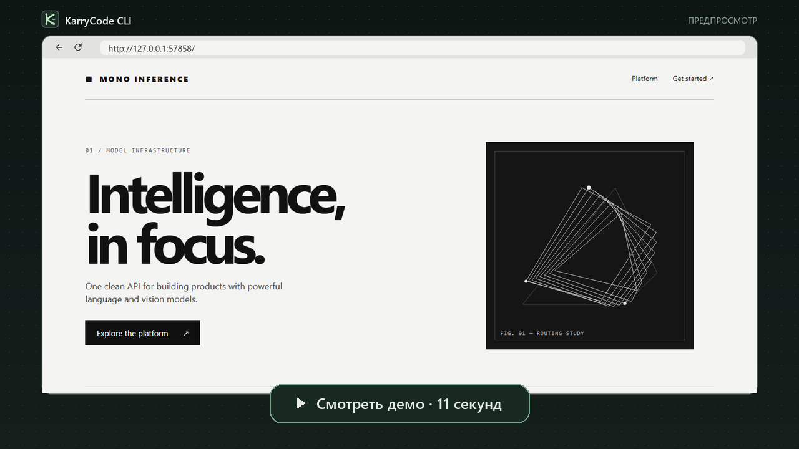

# KarryCode CLI

[English](../README.md)

KarryCode — агент для работы с кодом прямо из терминала. Выбери своего провайдера и модель, проверяй предлагаемые правки и открывай предпросмотр проекта. У KarryCode собственный профиль и установщик в экосистеме CarryCode.

## Быстрый старт

Windows PowerShell 5.1 или PowerShell 7:

```powershell
irm https://raw.githubusercontent.com/harzer228/KarryCode/main/install.ps1 | iex
karrycode
```

[](https://harzer228.github.io/KarryCode/demo/ru.html)

В 11-секундном ролике используется демо-модель. KarryCode записывает файл сайта и запускает локальный предпросмотр. Ожидание в ролике сокращено. [Смотреть в браузере](https://harzer228.github.io/KarryCode/demo/ru.html) · [Watch in English](https://harzer228.github.io/KarryCode/demo/)

Ubuntu или Arch Linux x64:

```sh
curl -fsSL https://raw.githubusercontent.com/harzer228/KarryCode/main/install.sh | sh
~/.local/bin/karrycode
```

Запусти `karrycode` в папке проекта или укажи путь после команды. Добавь подключение в `/provider`, выбери модель в `/model` и отправь задачу. `/cd` меняет папку в том же чате, `/setting` открывает настройки, `/help` показывает команды.

Профиль хранится в зашифрованных снимках. Windows разблокирует его через учётную запись. Linux использует доступное системное хранилище ключей или пароль. Для облачных моделей нужны интернет и доступ к провайдеру. Управление окнами доступно на Windows. Для инструментов браузера нужен установленный Chromium, Edge или Chrome.

Повтори команду установки для обновления. [Релизы и контрольные суммы](https://github.com/harzer228/KarryCode/releases/latest)
